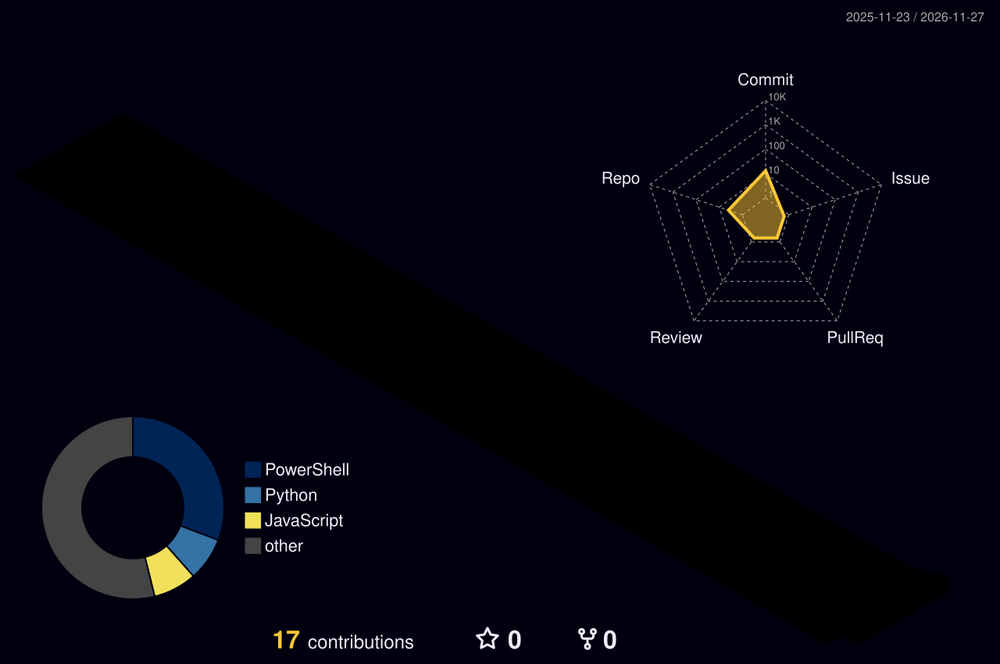

<!-- ✨ PROFESSIONAL PROFILE — Pooventhan Ramesh (@Darkkid32) ✨ -->
<div align="center">


<a href="https://github.com/Darkkid32">
  
</a>

<br/>


[](https://github.com/Darkkid32?tab=followers)
[](https://github.com/Darkkid32)

</div>

---

## 🙋‍♂️ About Me

```yaml
👤 Name        : Pooventhan Ramesh
💼 Role        : Cybersecurity Engineer @ Scyverge, Bengaluru 🇮🇳
🏭 Founder     : POPR 👕 | Co-Founder — Rishi Garments, Tiruppur
🏅 Certs       : CEH • Offensive C# • Vulnerability Identification
🛡️ Recognition : Govt. of India — Responsible Disclosure Acknowledgements
⚡ Philosophy  : "Bypass → Exploit → Patch → Re-run → Regression Proof" 🔁
```

- 🔐 **Security:** Pentesting, vulnerability assessment & hardening for web apps
- 🤖 **AI:** LLM / VLM annotation & QA (95%+ accuracy), AI agents & automation
- 🧠 **Building:** Sentinel 🛡️ (security assessment SaaS) • JARVIS 🎙️ (voice-controlled Windows assistant)
- 👕 **Business:** Running a 35+ member knitwear unit + the POPR baby-clothing brand
- 🌱 **Currently:** Hardening security tooling, shipping AI automation, growing POPR
- 💬 **Ask me about:** `Pentesting` • `Python` • `C#` • `AI Agents` • `Startup Building`

---

## 🛠️ Tech Stack & Arsenal 🧰

<div align="center">

### 🔐 Security


### 💻 Languages & Dev


### 🤖 AI & Data


</div>

---

## 📊 GitHub Stats 📈

<div align="center">


<br/>


</div>

---

## 🏆 GitHub Trophies

<div align="center">


</div>

---

## 🧊 3D Contribution Graph 🌌

<div align="center">

<!-- Generated daily by .github/workflows/profile-3d.yml — yoshi389111/github-profile-3d-contrib -->


<sub>✨ This 3D graph auto-updates every day at 00:00 UTC ✨</sub>

</div>

---

## 🚀 Featured Work

| 🎯 Project | 📝 What it is | 🛠️ Stack |
|---|---|---|
| 🛡️ **Sentinel** | Automated web security assessment SaaS — scan → exploit proof → patch verification | Python • Security Automation |
| 🎙️ **JARVIS** | Voice-controlled Windows assistant — full PC control by voice | Python • C# • AI Agents |
| 👕 **[POPR Website](https://github.com/Darkkid32/POPR-Website)** | E-commerce for the POPR baby-clothing brand | JavaScript • React |
| 🤖 **Robotics Data Venture** | Egocentric worker-video supply for robotics / AI training | AI Data • Operations |

---

## 📈 Activity Graph

<div align="center">


</div>

---

## 🤝 Connect With Me

<div align="center">

[](https://github.com/Darkkid32)
[](mailto:pooventhan.r@popr.in)
[](https://popr.in)

<br/>

### 💡 *"Security is not a product, but a process — prove it, don't just claim it."* 🛡️


</div>
